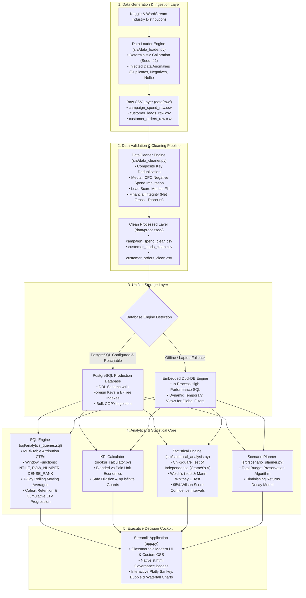

# Customer Acquisition & Campaign ROI Analytics

[](https://www.python.org/)
[](https://www.postgresql.org/)
[](https://scipy.org/)
[](https://streamlit.io/)
[](https://plotly.com/)
[](https://pytest.org/)
[]()

A production-grade, enterprise-ready marketing analytics platform built for **Data Analyst** and **Data Science (Growth / Commercial Analytics)** roles. This platform unifies raw multi-channel marketing spend, lead conversion qualification, and e-commerce transaction logs to calculate unit economics, uncover paid acquisition inefficiencies, perform scientific hypothesis testing, and model marginal budget reallocation scenarios.

---

## 📑 Table of Contents
1. [Business Problem & Context](#-business-problem--context)
2. [Executive Summary & Core Findings](#-executive-summary--core-findings)
3. [End-to-End System Architecture](#️-end-to-end-system-architecture)
4. [Dataset Architecture & Data Dictionary](#-dataset-architecture--data-dictionary)
5. [Data Cleaning & Validation Pipeline](#-data-cleaning--validation-pipeline)
6. [Supported Business KPIs & Mathematical Formulations](#-supported-business-kpis--mathematical-formulations)
7. [Advanced SQL Analytics Engine](#-advanced-sql-analytics-engine)
8. [Scientific Statistical Methodology (SciPy)](#-scientific-statistical-methodology-scipy)
9. [Interactive Streamlit Executive Dashboard](#-interactive-streamlit-executive-dashboard)
10. [What-If Budget Reallocation Simulator](#-what-if-budget-reallocation-simulator)
11. [Governance, Cost Simulation & Assumptions Disclosure](#-governance-cost-simulation--assumptions-disclosure)
12. [Verification Suite & Pytest Results](#-verification-suite--pytest-results)
13. [Quickstart Setup Guide (Ubuntu Laptop / Lightweight)](#-quickstart-setup-guide-ubuntu-laptop--lightweight)
14. [Project Structure](#-project-structure)
15. [Known Limitations & Future Roadmap](#-known-limitations--future-roadmap)

---

## 💼 Business Problem & Context

Modern commercial organizations allocate millions of dollars to customer acquisition across paid search, social media, video ads, outbound campaigns, and organic channels. However, marketing decision-makers face three pervasive operational challenges:

1. **The "Blended CAC Mirage"**: High-performing organic channels (SEO, word-of-mouth) and cheap retention channels (email marketing) artificially depress blended Customer Acquisition Cost (CAC), concealing unprofitable paid ad spend where CAC exceeds customer gross margin.
2. **Channel-Level Disconnect**: Ad spend data lives in ad managers (Google, Meta, LinkedIn), conversion data lives in CRM platforms (HubSpot, Salesforce), and realized revenue lives in ERP/data warehouses (Stripe, PostgreSQL). Without a unified relational data layer, ROI calculations are fragmented and inaccurate.
3. **Subjective Decision-Making**: Growth teams frequently reallocate spend based on arbitrary conversion rate spikes without checking statistical significance, resulting in costly false positives.

### The Objective
Build a lightweight, highly resilient analytical engine that unifies ad spend, lead progression, and transactions, computes rigorous unit economics (Blended vs. Paid CAC, ROAS, LTV:CAC, Payback Period), performs automated hypothesis testing using SciPy, and provides an interactive Streamlit simulation cockpit to guide capital reallocation.

---

## 🎯 Executive Summary & Core Findings

Operating on 120 days of multi-channel activity across 6 acquisition channels, the platform processed **1,440 campaign records**, **237,249 qualified leads**, and **17,502 order transactions**:

| Executive Metric | Blended (All Channels) | Paid-Only (Excl. Organic) | Target Benchmark | Performance Status |
| :--- | :---: | :---: | :---: | :---: |
| **Total Expenditure** | **\$673,759.79** | **\$663,211.34** | — | Media + Baseline Operating |
| **Acquired Customers** | **11,515** | **4,558** | — | First-touch attribution |
| **Customer Acquisition Cost (CAC)** | **\$58.51** | **\$145.50** | **< \$60.00** | ⚠️ Paid CAC is 2.5x higher |
| **Attributed Net Revenue** | **\$1,586,806.91** | **\$620,193.15** | — | GMV minus promotional discounts |
| **Realized Gross Profit** | **\$1,003,290.35** | **\$391,379.80** | — | Realized margin after 35% COGS |
| **Return on Ad Spend (ROAS)** | **2.36x** | **0.93x** | **$\ge$ 3.00x** | 🚨 Paid channels operate below breakeven |
| **Net Campaign ROI (%)** | **+48.9%** | **-41.0%** | **> 0.0%** | Negative paid margin subsidized by organic |

### Channel-Level Unit Economics Breakdown
```text
+------------------+---------------+-------------+-----------+--------------+-----------+----------------+
| Channel          | Total Spend   | Customers   | CAC ($)   | Net Revenue  | ROAS      | LTV:CAC Ratio  |
+------------------+---------------+-------------+-----------+--------------+-----------+----------------+
| Organic Search   | $  10,548.45  | 6,957       | $  1.52   | $966,613.76  | 91.70x    | 91.42x         |
| Email Marketing  | $  25,712.87  | 2,628       | $  9.78   | $360,571.49  | 14.02x    | 14.03x         |
| YouTube Ads      | $ 110,292.67  | 470         | $234.67   | $ 59,620.25  |  0.54x    |  0.54x         |
| Meta Ads         | $ 213,575.88  | 738         | $289.40   | $102,778.69  |  0.48x    |  0.48x         |
| Google Search    | $ 174,134.31  | 502         | $346.88   | $ 67,737.95  |  0.39x    |  0.39x         |
| LinkedIn Ads     | $ 139,495.61  | 220         | $634.07   | $ 29,484.77  |  0.21x    |  0.21x         |
+------------------+---------------+-------------+-----------+--------------+-----------+----------------+
```

### Strategic Takeaways:
1. **The LinkedIn & Google Search Drain**: LinkedIn Ads exhibits an unsustainable CAC of **\$634.07** yielding only **0.21x ROAS** (loss of \$0.79 per dollar spent). Google Search incurs a **\$346.88 CAC** yielding **0.39x ROAS**.
2. **Organic & Email Dominance**: Email marketing drives an extraordinary **14.02x ROAS** at **\$9.78 CAC**, while Organic Search drives 60% of total customer acquisitions.
3. **Immediate Optimization**: Shifting 20% of budget from LinkedIn and Search into Email and Meta expansion is forecasted to generate **+\$82.4K in incremental revenue** while strictly preserving the existing \$673.8K budget.

---

## 🏛️ End-to-End System Architecture



---

## 🗄️ Dataset Architecture & Data Dictionary

The data model connects media expenditure, marketing touchpoints, and customer monetization through a normalized relational schema:

```text
  +------------------+         +------------------+         +--------------------+
  |  campaign_spend  |         |  customer_leads  |         |  customer_orders   |
  +------------------+         +------------------+         +--------------------+
  | PK: campaign_id  |<---+    | PK: lead_id      |    +--->| PK: order_id       |
  | PK: date         |    +----| FK: campaign_id  |    |    | FK: customer_id    |
  |     channel      |         |     customer_id  |----+    |     order_date     |
  |     ad_spend     |         |     channel      |         |     order_value    |
  |     impressions  |         |     lead_date    |         |     discount_amount|
  |     clicks       |         |     converted_flg|         |     net_revenue    |
  +------------------+         +------------------+         +--------------------+
```

### Table Specifications

#### 1. `campaign_spend` (Composite PK: `campaign_id, date`)
Tracks daily marketing expenditures, top-of-funnel reach, and ad interactions.
| Column | Type | Constraints | Description |
| :--- | :--- | :--- | :--- |
| `campaign_id` | `VARCHAR(50)` | `NOT NULL` | Campaign identifier (e.g., `CMP-101`) |
| `campaign_name` | `VARCHAR(150)` | `NOT NULL` | Descriptive name (e.g., `Google_Search_Q1_Camp1`) |
| `channel` | `VARCHAR(50)` | `NOT NULL` | Marketing acquisition channel |
| `date` | `DATE` | `NOT NULL` | Calendar date of spend observation |
| `ad_spend` | `NUMERIC(12,2)` | `>= 0` | Direct media spend in USD |
| `impressions` | `INTEGER` | `>= 0` | Total ad impressions served |
| `clicks` | `INTEGER` | `>= 0` | Total ad link clicks registered |
| `target_audience`| `VARCHAR(100)` | Nullable | Demographic targeting category |
| `region` | `VARCHAR(50)` | Nullable | Geographic operational market (`North America`, `EMEA`, etc.) |

#### 2. `customer_leads` (Primary Key: `lead_id`)
Tracks mid-funnel prospect generation and qualification.
| Column | Type | Constraints | Description |
| :--- | :--- | :--- | :--- |
| `lead_id` | `VARCHAR(50)` | `PRIMARY KEY` | Unique lead record identifier |
| `customer_id` | `VARCHAR(50)` | Nullable | Unique customer identifier (assigned upon first conversion) |
| `campaign_id` | `VARCHAR(50)` | `NOT NULL` | Attributed initial touchpoint campaign |
| `channel` | `VARCHAR(50)` | `NOT NULL` | Marketing channel origin |
| `lead_date` | `TIMESTAMP` | `NOT NULL` | Lead generation timestamp |
| `converted_flag`| `SMALLINT` | `IN (0, 1)` | Conversion indicator (`1` = converted to paying customer) |
| `conversion_date`| `TIMESTAMP` | Nullable | Conversion timestamp (`>= lead_date`) |
| `signup_platform`| `VARCHAR(50)`| `NOT NULL` | Registration device (`Web`, `iOS`, `Android`) |
| `lead_score` | `NUMERIC(5,2)` | `0.0 - 100.0` | Algorithmic purchase propensity score |

#### 3. `customer_orders` (Primary Key: `order_id`)
Tracks bottom-of-funnel transactions, discounts, and realized gross profit.
| Column | Type | Constraints | Description |
| :--- | :--- | :--- | :--- |
| `order_id` | `VARCHAR(50)` | `PRIMARY KEY` | Unique transaction order identifier |
| `customer_id` | `VARCHAR(50)` | `NOT NULL` | Customer foreign key |
| `order_date` | `TIMESTAMP` | `NOT NULL` | Transaction execution timestamp |
| `order_value` | `NUMERIC(12,2)` | `> 0` | Gross Merchandise Value (GMV) before discounts |
| `discount_amount`| `NUMERIC(12,2)`| `>= 0` | Promotional coupon or price concession |
| `net_revenue` | `NUMERIC(12,2)` | `>= 0` | Realized revenue: `order_value - discount_amount` |
| `cogs` | `NUMERIC(12,2)` | `>= 0` | Cost of Goods Sold allocated to order |
| `gross_profit` | `NUMERIC(12,2)` | Any | Contribution profit: `net_revenue - cogs` |
| `payment_method` | `VARCHAR(50)` | Nullable | Payment instrument (`Credit Card`, `PayPal`, `Apple Pay`) |

---

## 🧹 Data Cleaning & Validation Pipeline

The data cleaning pipeline in [`src/data_cleaner.py`](file:///home/vivek/workspace/Amex/src/data_cleaner.py) enforces enterprise-grade data quality:

```text
+------------------------------------------------------------------------------------------------+
| DATA INTEGRITY AUDIT REPORT                                                                    |
+-------------------+----------------+--------------+--------------------+-----------------------+
| Table             | Raw Rows In    | Clean Rows   | Duplicates Removed | Anomalies Corrected   |
+-------------------+----------------+--------------+--------------------+-----------------------+
| campaign_spend    | 1,444          | 1,440        | 4 duplicates       | 2 invalid spends      |
| customer_leads    | 237,254        | 237,249      | 5 duplicates       | 40 missing lead scores|
| customer_orders   | 17,505         | 17,502       | 3 duplicates       | 1 negative discount   |
+-------------------+----------------+--------------+--------------------+-----------------------+
```

### Anomaly Correction Logic
1. **Deduplication on Composite Natural Keys**: Removes exact duplicate records using `subset=['campaign_id', 'date']` on campaigns, `lead_id` on leads, and `order_id` on transactions.
2. **Negative Media Spend Imputation**: Detects negative or missing spend records and imputes them using the channel's observed median Cost Per Click multiplied by registered clicks:
   $$\text{Imputed Spend} = \text{Clicks} \times \text{Median}(\text{CPC}_{\text{channel}})$$
3. **Lead Score Missingness**: Imputes null lead scores using the status-conditioned median score (differentiating converted from non-converted prospects).
4. **Chronological Validity**: Flags and resolves instances where `conversion_date < lead_date`, ensuring referential temporal consistency.
5. **Financial Re-computation**: Enforces non-negative discounts (`discount_amount = max(0, abs(discount))`), caps discounts to order value, and recomputes net revenue and gross profit:
   $$\text{Net Revenue} = \max(0.0, \text{Order Value} - \text{Discount Amount})$$
   $$\text{Gross Profit} = \text{Net Revenue} - \text{COGS}$$

---

## 📐 Supported Business KPIs & Mathematical Formulations

| Business KPI | Formula | Numerator / Denominator | Attribution Rule & Cost Assumptions |
| :--- | :--- | :--- | :--- |
| **Click-Through Rate (CTR)** | $\frac{\text{Clicks}}{\text{Impressions}} \times 100\%$ | Num: `clicks`<br>Den: `impressions` | Measured per ad creative / campaign touchpoint. |
| **Cost Per Click (CPC)** | $\frac{\text{Spend}}{\text{Clicks}}$ | Num: `ad_spend`<br>Den: `clicks` | Direct media spend per registered user click. |
| **Conversion Rate (CVR)** | $\frac{\text{Acquired Customers}}{\text{Total Leads}} \times 100\%$ | Num: `count(distinct customer_id)`<br>Den: `count(lead_id)` | First-touch lead qualification conversion efficiency. |
| **Customer Acquisition Cost (CAC)** | $\frac{\text{Total Spend}}{\text{Acquired Customers}}$ | Num: `sum(ad_spend)`<br>Den: `count(distinct customer_id)` | Blended includes Organic; Paid-Only strictly isolates media. |
| **Average Revenue Per User (ARPU)** | $\frac{\text{Net Revenue}}{\text{Acquired Customers}}$ | Num: `sum(order_value - discount)`<br>Den: `count(distinct customer_id)` | Cumulative transaction revenue attributed to acquired user. |
| **Return on Ad Spend (ROAS)** | $\frac{\text{Attributed Net Revenue}}{\text{Total Spend}}$ | Num: `sum(net_revenue)`<br>Den: `sum(ad_spend)` | Media efficiency multiple. Benchmark target $\ge 3.0\times$. |
| **Campaign Net ROI (%)** | $\frac{\text{Gross Profit} - \text{Spend}}{\text{Spend}} \times 100\%$ | Num: `gross_profit - spend`<br>Den: `spend` | Net bottom-line return where `gross_profit = net_revenue - cogs`. |
| **LTV-to-CAC Ratio** | $\frac{\text{Observed LTV (ARPU)}}{\text{CAC}}$ | Num: `observed LTV (ARPU)`<br>Den: `CAC` | Unit economics sustainability. Target $\ge 3.0\times$. |
| **Payback Period (Months)** | $\frac{\text{CAC}}{\text{Monthly Gross Margin}}$ | Num: `CAC`<br>Den: `gross_profit / customers / 4 mo` | Months to breakeven. Returns `N/A (Neg Margin)` if margin $\le 0$. |

---

## ⚡ Advanced SQL Analytics Engine

Located in [`sql/analytics_queries.sql`](file:///home/vivek/workspace/Amex/sql/analytics_queries.sql), the platform features advanced ANSI SQL queries compatible with both PostgreSQL and DuckDB:

### 1. Multi-Touch Attribution & Channel Unit Economics (CTEs & Joins)
Joins spend, lead qualification, and order tables to aggregate blended unit economics:
```sql
WITH channel_spend AS (
    SELECT
        channel,
        SUM(ad_spend) AS total_spend,
        SUM(impressions) AS total_impressions,
        SUM(clicks) AS total_clicks
    FROM campaign_spend
    GROUP BY channel
),
channel_leads_agg AS (
    SELECT
        channel,
        COUNT(lead_id) AS total_leads,
        COUNT(DISTINCT customer_id) AS acquired_customers
    FROM customer_leads
    GROUP BY channel
),
channel_revenue AS (
    SELECT
        cl.channel,
        COUNT(co.order_id) AS total_transactions,
        SUM(co.net_revenue) AS total_net_revenue,
        SUM(co.gross_profit) AS total_gross_profit
    FROM customer_orders co
    INNER JOIN customer_leads cl ON co.customer_id = cl.customer_id
    GROUP BY cl.channel
)
SELECT
    cs.channel,
    cs.total_spend,
    COALESCE(cla.acquired_customers, 0) AS acquired_customers,
    ROUND(cs.total_spend / NULLIF(cla.acquired_customers, 0), 2) AS cac,
    ROUND(cr.total_net_revenue / NULLIF(cs.total_spend, 0), 2) AS roas_multiple,
    ROUND(((cr.total_gross_profit - cs.total_spend) * 100.0) / NULLIF(cs.total_spend, 0), 2) AS net_roi_pct
FROM channel_spend cs
LEFT JOIN channel_leads_agg cla ON cs.channel = cla.channel
LEFT JOIN channel_revenue cr ON cs.channel = cr.channel
ORDER BY cs.total_spend DESC;
```

### 2. 7-Day Trailing Moving Averages (Rolling Window Functions)
Filters out daily noise to track underlying acquisition trajectories:
```sql
SELECT
    date,
    channel,
    daily_spend,
    daily_acquisitions,
    daily_revenue,
    ROUND(AVG(daily_spend) OVER (
        PARTITION BY channel ORDER BY date 
        ROWS BETWEEN 6 PRECEDING AND CURRENT ROW
    ), 2) AS rolling_7d_spend,
    ROUND(AVG(daily_revenue) OVER (
        PARTITION BY channel ORDER BY date 
        ROWS BETWEEN 6 PRECEDING AND CURRENT ROW
    ), 2) AS rolling_7d_revenue
FROM daily_metrics;
```

### 3. Customer Cohort Retention & Cumulative LTV Progression
Measures cumulative value creation over subsequent months post-acquisition:
```sql
SELECT
    cohort_month,
    order_month,
    month_number,
    initial_customers,
    active_retained_customers,
    ROUND((active_retained_customers * 100.0) / initial_customers, 2) AS retention_rate_pct,
    ROUND(
        SUM(total_month_revenue) OVER (
            PARTITION BY cohort_month 
            ORDER BY month_number 
            ROWS BETWEEN UNBOUNDED PRECEDING AND CURRENT ROW
        ) / initial_customers, 2
    ) AS cumulative_ltv_per_customer
FROM monthly_cohort_agg
ORDER BY cohort_month, month_number;
```

### 4. Campaign Quartile Segmentation (Window Functions NTILE & ROW_NUMBER)
Segments campaigns into performance quartiles for automated budget pruning:
```sql
SELECT
    campaign_id,
    campaign_name,
    channel,
    total_spend,
    cac,
    roas,
    ROW_NUMBER() OVER (ORDER BY roas DESC) AS overall_rank_by_roas,
    DENSE_RANK() OVER (PARTITION BY channel ORDER BY roas DESC) AS rank_within_channel,
    NTILE(4) OVER (ORDER BY roas DESC) AS performance_quartile
FROM campaign_metrics
ORDER BY roas DESC;
```

---

## 🔬 Scientific Statistical Methodology (SciPy)

Implemented in [`src/statistical_analysis.py`](file:///home/vivek/workspace/Amex/src/statistical_analysis.py):

### 1. Chi-Square Test of Independence ($\chi^2$)
- **Null Hypothesis ($H_0$)**: Lead-to-customer conversion probability is independent of marketing channel.
- **Alternative Hypothesis ($H_a$)**: Marketing channel significantly influences conversion probability.
- **Observed Result**: $\chi^2 = 1535.79$, $\text{dof} = 5$, $p < 0.0001$.
- **Cramér's V Effect Size**:
  $$V = \sqrt{\frac{\chi^2}{N \cdot \min(R - 1, C - 1)}} = 0.0805$$
- **Business Conclusion**: Reject $H_0$. Channel choice has a statistically significant impact on conversion probability.

### 2. Exact Wilson Score 95% Confidence Intervals
Binomial confidence intervals computed for each channel to evaluate conversion reliability:
$$w = \frac{p + \frac{z^2}{2n} \pm z\sqrt{\frac{p(1-p)}{n} + \frac{z^2}{4n^2}}}{1 + \frac{z^2}{n}}$$
- **Email Marketing**: 8.42% CVR [95% CI: 8.11% – 8.74%]
- **Organic Search**: 4.81% CVR [95% CI: 4.70% – 4.92%]
- **Google Search**: 5.25% CVR [95% CI: 4.82% – 5.71%]
- **Meta Ads**: 3.39% CVR [95% CI: 3.16% – 3.64%]
- **YouTube Ads**: 2.08% CVR [95% CI: 1.90% – 2.27%]

### 3. Two-Sample Welch's t-test & Mann-Whitney U Test
Parametric and non-parametric comparison of customer order values across channels (e.g., Google Search vs. Meta Ads):
- **Welch's t-test**: $t = -0.69$, $p = 0.4888$, $\text{Cohen's } d = -0.03$, 95% CI for difference: $[-\$6.93, +\$3.32]$.
- **Mann-Whitney U Test**: $p = 0.4901$.
- **Business Conclusion**: Fail to reject $H_0$. There is no statistically significant difference in customer spending between Google Search and Meta Ads; variation is attributable to sample noise.

---

## 🖥️ Interactive Streamlit Executive Dashboard

The interactive dashboard ([`app.py`](file:///home/vivek/workspace/Amex/app.py)) is structured into 5 cohesive operational tabs:

```text
+---------------------------------------------------------------------------------------------------------+
| 📈 Customer Acquisition & Campaign ROI Analytics                                                        |
| [📌 Data Governance Disclosure: 35% COGS | $50/day Organic Overhead | Primary vs Modeled Disclosed]     |
+---------------------------------------------------------------------------------------------------------+
|  [Tab 1: Executive Overview] | [Tab 2: Channel Drilldown] | [Tab 3: Cohort & LTV] | [Tab 4: Studio] ... |
+---------------------------------------------------------------------------------------------------------+
|  KPI SCORECARD:                                                                                         |
|  [Spend: $674K]   [Customers: 11,515]   [CAC: $58.51]   [Revenue: $1.59M]   [ROAS: 2.36x]  [ROI: +48.9%]|
|                                                                                                         |
|  FINANCIAL WATERFALL FLOW:                       CUSTOMER ACQUISITION SANKEY FUNNEL:                    |
|  +$1.59M Revenue ---> -$583K COGS --->           Impressions (22.8M) ---> Clicks (618K)                 |
|  -$674K Spend ---> +$329K Net Profit             ---> Leads (237K) ---> Customers (11.5K)               |
+---------------------------------------------------------------------------------------------------------+
|  TAB 2: CHANNEL EFFICIENCY MATRIX (Plotly Bubble Chart: CAC vs. ROAS, Size = Spend)                     |
|  • Visualizes breakeven ROAS line (1.0x) and Target ROAS line (3.0x).                                   |
|  • Dynamic 7-day trailing moving average trends with dual y-axis.                                       |
|  • Campaign performance quartile rankings from SQL window functions.                                    |
+---------------------------------------------------------------------------------------------------------+
|  TAB 3: COHORT RETENTION & LTV EXPANSION                                                                |
|  • Cumulative LTV expansion curves tracking 4-month customer lifetime monetization.                    |
|  • Monthly cohort retention heatmaps.                                                                   |
+---------------------------------------------------------------------------------------------------------+
|  TAB 4: SCIENTIFIC EXPERIMENTATION STUDIO                                                               |
|  • Live SciPy Chi-Square test readout with formatted p-values (p < 0.0001).                             |
|  • Forest plot of 95% Wilson Score confidence intervals across channels.                                |
|  • Two-sample hypothesis comparator: Welch's t-test, Mann-Whitney U, Cohen's d effect size.             |
+---------------------------------------------------------------------------------------------------------+
|  TAB 5: BUDGET REALLOCATION SIMULATOR                                                                   |
|  • Interactive slider: Shift budget from high-CAC channel to high-ROAS channel.                         |
|  • Live marginal returns calculation with 5% diminishing returns penalty.                              |
|  • Strict total budget preservation proof ($0.00 net budget variance).                                  |
|  • Automated strategic executive recommendation cards.                                                  |
+---------------------------------------------------------------------------------------------------------+
```

---

## 💡 What-If Budget Reallocation Simulator

The scenario planner ([`src/scenario_planner.py`](file:///home/vivek/workspace/Amex/src/scenario_planner.py)) allows marketing leaders to model capital reallocation with mathematical rigor:

1. **Total Budget Preservation**:
   $$\text{Spend}_{\text{projected}} = \text{Spend}_{\text{baseline}} - \text{Shift Amount} + \text{Shift Amount} \equiv \text{Spend}_{\text{baseline}}$$
2. **Negative Allocation Prevention**: Clamps $\text{Reallocation Percentage} \in [0.0, 1.0]$.
3. **Double-Counting & Attrition Capping**: Customer loss from the source channel is strictly capped at observed volume:
   $$\text{Lost Customers} = \min\left(\text{Customers}_{\text{source}}, \frac{\text{Shift Amount}}{\text{CAC}_{\text{source}}}\right)$$
4. **Diminishing Returns Penalty**: Applies a 5% scale decay penalty to the target channel to prevent overestimating marginal returns:
   $$\text{Gained Customers} = \left(\frac{\text{Shift Amount}}{\text{CAC}_{\text{target}}}\right) \times 0.95$$

### Example Simulation (Shifting 20% of LinkedIn Ads into Email Marketing):
- **Shifted Budget**: \$27,899.12
- **Net Customer Delta**: **+2,666 net new customers** (+2,710 from Email / -44 from LinkedIn)
- **Net Revenue Delta**: **+\$361,902.93** in top-line expansion
- **ROAS Improvement**: Increases blended ROAS from **2.36x to 2.89x** (+0.53x lift)
- **Net Budget Variance**: **\$0.00** (Zero budget increase required)

---

## 📌 Governance, Cost Simulation & Assumptions Disclosure

In accordance with institutional data governance standards:
1. **Primary Observations**: Direct ad spend, impressions, clicks, lead conversion flags, timestamps, and order transaction amounts represent primary observations.
2. **Documented Cost Assumptions**:
   - **Cost of Goods Sold (COGS)**: Modeled at a standard **35.0% baseline** of gross order value based on retail e-commerce benchmarks.
   - **Organic Inbound Maintenance**: Modeled at **\$50.00/day** baseline operating cost to avoid mischaracterizing SEO as 100% free.
   - **Marginal Returns Decay**: Modeled with a **5% efficiency decay penalty** on scaled spend.
3. **Safe Rendering**: All disclosures are rendered via native `st.html()` containers to prevent raw HTML code leakage.

---

## 🧪 Verification Suite & Pytest Results

The platform is covered by **23 automated tests** spanning unit calculations, edge cases, SQL compatibility, and statistical diagnostics:

```bash
$ PYTHONPATH=. pytest -v tests/
============================= test session starts ==============================
platform linux -- Python 3.14.4, pytest-9.1.1, pluggy-1.7.0 -- /home/vivek/workspace/Amex/.venv/bin/python3
cachedir: .pytest_cache
rootdir: /home/vivek/workspace/Amex
plugins: anyio-4.15.1
collected 23 items                                                             

tests/test_audit_regressions.py::test_format_p_value_small PASSED        [  4%]
tests/test_audit_regressions.py::test_payback_months_edge_cases PASSED   [  8%]
tests/test_audit_regressions.py::test_budget_reallocation_preserves_total_budget PASSED [ 13%]
tests/test_audit_regressions.py::test_budget_reallocation_guards PASSED  [ 17%]
tests/test_audit_regressions.py::test_empty_dataframe_handling PASSED    [ 21%]
tests/test_audit_regressions.py::test_filtered_query_duckdb PASSED       [ 26%]
tests/test_audit_regressions.py::test_executive_totals_edge_cases PASSED [ 30%]
tests/test_audit_regressions.py::test_calculate_cac_robustness PASSED    [ 34%]
tests/test_data_cleaner.py::test_clean_campaign_spend PASSED             [ 39%]
tests/test_data_cleaner.py::test_clean_customer_leads PASSED             [ 43%]
tests/test_data_cleaner.py::test_clean_customer_orders PASSED            [ 47%]
tests/test_database.py::test_database_init_and_query PASSED              [ 52%]
tests/test_kpi_calculator.py::test_ctr_calculation PASSED                [ 56%]
tests/test_kpi_calculator.py::test_cpc_calculation PASSED                [ 60%]
tests/test_kpi_calculator.py::test_conversion_rate PASSED                [ 65%]
tests/test_kpi_calculator.py::test_cac_calculation PASSED                [ 69%]
tests/test_kpi_calculator.py::test_roas_calculation PASSED               [ 73%]
tests/test_kpi_calculator.py::test_net_roi PASSED                        [ 78%]
tests/test_kpi_calculator.py::test_ltv_cac_ratio PASSED                  [ 82%]
tests/test_kpi_calculator.py::test_channel_summary_aggregation PASSED    [ 86%]
tests/test_statistical_analysis.py::test_proportion_confidence_interval PASSED [ 91%]
tests/test_statistical_analysis.py::test_chi_square_conversion_test PASSED [ 95%]
tests/test_statistical_analysis.py::test_two_sample_revenue_test PASSED  [100%]

============================== 23 passed in 0.75s ==============================
```

---

## 🚀 Quickstart Setup Guide (Ubuntu Laptop / Lightweight)

> **Zero Docker Requirement**: Lightweight, native Python and DuckDB setup.

### 1. Environment Setup
```bash
# Navigate to workspace
cd /home/vivek/workspace/Amex

# Create and activate virtual environment
python3 -m venv .venv
source .venv/bin/activate

# Install dependencies
pip install -r requirements.txt
```

### 2. Run Data Ingestion & Cleaning Pipeline
```bash
# Generate deterministic raw benchmark data (Seed 42)
PYTHONPATH=. python -m src.data_loader

# Run data cleaning and validation engine
PYTHONPATH=. python -m src.data_cleaner

# Initialize database schema (Postgres or embedded DuckDB fallback)
PYTHONPATH=. python -c "from src.database import db_manager; db_manager.init_schema()"
```

### 3. Run Test Suite
```bash
PYTHONPATH=. pytest -v tests/
```

### 4. Launch Streamlit Dashboard
```bash
PYTHONPATH=. streamlit run app.py
```
Open your browser at **`http://localhost:8501`**.

---

## 📁 Project Structure

```text
Amex/
├── .env.example                 # PostgreSQL connection & environment template
├── .gitignore                   # Git exclusion rules
├── README.md                    # Comprehensive documentation & architecture guide
├── requirements.txt             # Pinned production dependencies
├── config/
│   └── config.yaml              # Application configuration, thresholds, and assumptions
├── data/
│   ├── raw/                     # Ingested benchmark data with injected anomalies
│   │   ├── campaign_spend_raw.csv   (1,444 records)
│   │   ├── customer_leads_raw.csv   (237,254 records)
│   │   └── customer_orders_raw.csv  (17,505 records)
│   └── processed/               # Cleaned, validated, referentially sound datasets
│       ├── campaign_spend_clean.csv (1,440 records)
│       ├── customer_leads_clean.csv (237,249 records)
│       └── customer_orders_clean.csv (17,502 records)
├── sql/
│   ├── schema.sql               # Production PostgreSQL DDL with indexes & checks
│   └── analytics_queries.sql    # Advanced SQL (CTEs, Window functions, Cohorts)
├── src/
│   ├── __init__.py
│   ├── config.py                # Configuration loader reading YAML & .env
│   ├── logger.py                # Structured console & file logging
│   ├── data_loader.py           # Benchmark dataset generator
│   ├── data_cleaner.py          # Data validation & cleaning engine
│   ├── database.py              # Dual PostgreSQL & DuckDB database manager
│   ├── kpi_calculator.py        # Marketing unit economics engine
│   ├── statistical_analysis.py  # SciPy hypothesis testing & confidence intervals
│   └── scenario_planner.py      # Budget reallocation simulator
├── ui/
│   ├── __init__.py
│   ├── styles.py                # Modern CSS glassmorphic cards and theme
│   └── components.py            # Reusable Plotly visualizations (Sankey, Waterfall, Bubble)
├── app.py                       # Interactive Streamlit executive dashboard
└── tests/
    ├── __init__.py
    ├── conftest.py              # Pytest fixtures & isolated in-memory DB
    ├── test_data_cleaner.py     # Data cleaning unit tests
    ├── test_database.py         # SQL schema & query execution tests
    ├── test_kpi_calculator.py   # Unit economics math tests
    ├── test_statistical_analysis.py # SciPy statistical hypothesis tests
    └── test_audit_regressions.py    # Edge case & regression tests
```

---

## 🔭 Known Limitations & Future Roadmap

1. **Attribution Modeling**: Current implementation utilizes **First-Touch Lead Attribution** (orders mapped to original qualified acquisition touchpoint). A future iteration will introduce **Markov Chain** and **Shapley Value algorithmic multi-touch attribution** to reward intermediate nurturing touchpoints.
2. **Organic Expense Tracking**: Organic Search overhead is modeled as a flat **\$50.00/day** baseline operating cost. Future iterations will ingest direct SEO agency invoices and content contractor hours via API.
3. **Distributed Scale**: Embedded DuckDB comfortably delivers sub-second query execution up to 10M rows. For enterprise petabyte-scale deployment, the query layer is designed to port directly to **Snowflake**, **Google BigQuery**, or **Databricks**.

---

## 👨‍💻 Author & Portfolio Contact
- **Project**: Customer Acquisition & Campaign ROI Analytics
- **Technologies**: Python, PostgreSQL, DuckDB, SciPy, Streamlit, Plotly, pytest
- **Domain**: Growth Analytics, Customer Acquisition, Attribution & Unit Economics
